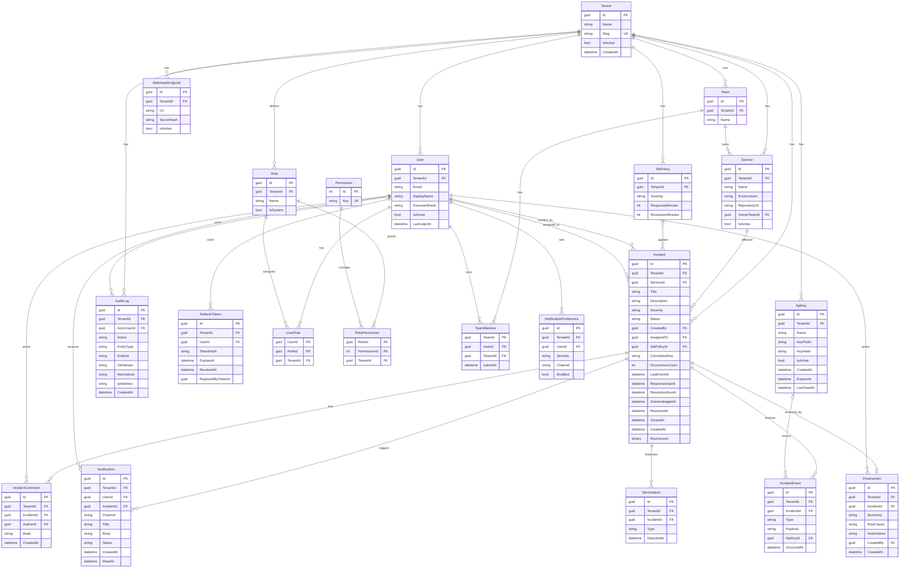

# OpsPilot: ERD وتصميم قاعدة البيانات

## 1. القواعد العامة

- كل جدول يخص شركة فيه `TenantId` (NOT NULL) وفهرس يبدأ بـ `TenantId`، وعليه Global Query Filter في EF Core.
- الجدول العام الوحيد بدون `TenantId`: `Permission` (قائمة الصلاحيات ثابتة في الكود). الأدوار خاصة بكل شركة (`Role` و`RolePermission` فيهم `TenantId`).
- كل الـ Ids من نوع `Guid`، وكل التواريخ `datetime2` بتوقيت UTC.
- الحذف Soft Delete (`IsActive`) للكيانات الأساسية، عشان الحوادث القديمة ما تفقدش مرجعها.
- `AuditLog` و`IncidentEvent` جداول إضافة فقط (Append-only): لا Update ولا Delete.
- `RowVersion` (`rowversion`) على `Incident` لمنع التعارض لما اتنين يغيّروا الحالة في نفس اللحظة (Optimistic Concurrency).

## 2. الرسمة (ERD)

جداول بنية تحتية (بدون علاقات، مش في الرسمة): `OutboxMessage`, `InboxMessage`, `AiSuggestion`.

## 3. تفاصيل الجداول والفهارس

### Identity و Tenancy

| الجدول | ملاحظات | الفهارس / القيود |
|---|---|---|
| **Tenant** | جذر العزل | `UNIQUE(Slug)` |
| **User** | مبني على ASP.NET Identity (`IdentityUser<Guid>`). الشركة الواحدة ليها مستخدمين كتير عن طريق `TenantId` (FK) | `UNIQUE(NormalizedEmail)` **على مستوى النظام كله**، لأن الـ Login بالإيميل بدون اسم شركة. في v1 الشخص الواحد في شركة واحدة فقط. `INDEX(TenantId)` |
| **RefreshToken** | **ناقص من الـ Blueprint**: لازم لتدوير الـ Token. نخزن Hash فقط | `INDEX(UserId)`, `UNIQUE(TokenHash)`. لو استُخدم Token اتلغى قبل كده، نلغي كل سلسلته (Reuse Detection) |
| **Role** | خاص بكل شركة. عند إنشاء الشركة ننسخ لها 5 أدوار افتراضية (Owner, Admin, TeamLead, Engineer, Viewer) بـ `IsSystem = true`. الـ Admin يقدر يضيف أدوار مخصصة (`IsSystem = false`) | `UNIQUE(TenantId, Name)` |
| **Permission** | Seed، مثل `incidents.read` | `UNIQUE(Key)` |
| **RolePermission** | ربط، وفيه `TenantId` للعزل | PK مركب `(RoleId, PermissionId)` |
| **UserRole** | ربط مع `TenantId` | PK مركب `(UserId, RoleId)` |

**قواعد الأدوار المخصصة:**

- أدوار `IsSystem = true` ما تتحذفش ولا تتغير أسماؤها. دور **Owner** بالذات صلاحياته ما تتعدلش، حتى لا تفقد الشركة السيطرة.
- الـ Admin ما يقدر يدّي دور فيه صلاحية هو نفسه ما يملكهاش (منع رفع الصلاحيات الذاتي)، وما يقدر يمنح Owner.
- دور مربوط بمستخدمين ما يتحذفش، لازم يتنقلوا لدور تاني الأول.
- لازم نضمن إن الـ `User` والـ `Role` في `UserRole` من نفس الشركة. الأقوى إنك تضيف `UNIQUE(TenantId, Id)` على `User` و`Role`، وتخلي الـ FK في `UserRole` مركب `(TenantId, UserId)` و`(TenantId, RoleId)`. لو ده تقيل، اعمله كتحقق في الكود مع اختبار تكامل.
- تغيير أي دور أو صلاحياته يتسجل في الـ Audit (`RoleChanged`)، وبما إن الصلاحيات محمّلة كـ Claims في الـ Token، التغيير يظهر بعد تجديده (مدته 15 دقيقة).

### الفرق والخدمات

| الجدول | ملاحظات | الفهارس / القيود |
|---|---|---|
| **Team** | | `UNIQUE(TenantId, Name)` |
| **TeamMember** | ربط User و Team | PK مركب `(TeamId, UserId)` |
| **Service** | `Environment` قيمها: Development / Staging / Production | `UNIQUE(TenantId, Name, Environment)`, `INDEX(TenantId, OwnerTeamId)` |

### الحوادث

| الجدول | ملاحظات | الفهارس / القيود |
|---|---|---|
| **Incident** | القلب. `Severity` و`Status` نخزنهم كنص (`HasConversion<string>`) عشان القراءة سهلة | `INDEX(TenantId, Status)`, `INDEX(TenantId, ServiceId, CreatedAt)`, `INDEX(TenantId, CorrelationKey)`, `INDEX(TenantId, AssignedTo)` |
| **IncidentComment** | | `INDEX(TenantId, IncidentId, CreatedAt)` |
| **IncidentEvent** | الـ Timeline والأحداث الخام. `Type` مثل: EventReceived, StatusChanged, Assigned, CommentAdded, SlaViolated. `ApiKeyId` فاضي لو الحدث من مستخدم | `INDEX(TenantId, IncidentId, OccurredAt)` |
| **Postmortem** | علاقة 1 لـ 1 مع Incident | `UNIQUE(IncidentId)` |

**فهرس ضم الأحداث (مهم):** أنشئ فهرساً فريداً مفلتراً على الحوادث المفتوحة فقط:
`UNIQUE(TenantId, CorrelationKey) WHERE Status NOT IN ('Resolved','Closed')`
كده حتى لو وصل حدثان متزامنان، قاعدة البيانات نفسها تمنع إنشاء حادثتين مفتوحتين لنفس المفتاح. الـ Handler يمسك الخطأ ويضم الحدث للحادثة الموجودة.

### SLA والإشعارات

| الجدول | ملاحظات | الفهارس / القيود |
|---|---|---|
| **SlaPolicy** | صف لكل خطورة لكل شركة، ويتعمل Seed بالقيم الافتراضية عند إنشاء الشركة | `UNIQUE(TenantId, Severity)` |
| **SlaViolation** | `Type`: Response أو Resolution | `UNIQUE(IncidentId, Type)` عشان مهمة Hangfire ما تكررش الإشعار |
| **Notification** | `Channel`: SignalR / Email / Webhook. `Status`: Pending / Sent / Failed | `INDEX(TenantId, UserId, ReadAt)` |
| **NotificationPreference** | | `UNIQUE(UserId, Severity, Channel)` |
| **WebhookEndpoint** | **ناقص من الـ Blueprint**: قناة الـ Webhook محتاجة مكان تخزن فيه الرابط والسر. لو قصّيت الـ Webhook (القسم 7.2) احذف الجدول | `INDEX(TenantId)` |

### التدقيق والمفاتيح

| الجدول | ملاحظات | الفهارس / القيود |
|---|---|---|
| **AuditLog** | إضافة فقط. `OldValues` و`NewValues` JSON. `ActorUserId` فاضي لأفعال النظام مثل SLA | `INDEX(TenantId, CreatedAt)`, `INDEX(TenantId, EntityType, EntityId)` |
| **ApiKey** | نخزن `KeyHash` فقط (SHA-256). الـ `KeyPrefix` (أول 8 حروف) للبحث السريع وللعرض في الواجهة | `UNIQUE(KeyPrefix)` |

### جداول البنية التحتية (بدون TenantId)

| الجدول | الحقول | الغرض |
|---|---|---|
| **OutboxMessage** | Id, Type, Payload, TenantId (للتتبع فقط), CreatedAt, ProcessedAt, Attempts, Error | نمط Outbox. `INDEX(ProcessedAt) WHERE ProcessedAt IS NULL` |
| **InboxMessage** | MessageId (PK), Consumer, ProcessedAt | **إضافة مني**: تمنع الـ Consumer من معالجة نفس الرسالة مرتين (RabbitMQ يضمن "مرة على الأقل" مش "مرة واحدة") |
| **AiSuggestion** | Id, TenantId, IncidentId, Kind, Content, Model, CreatedAt, AcceptedAt | **المرحلة 6 فقط (اختياري)**. يخزن مخرجات الـ AI كاقتراحات منفصلة عن الحقائق |

## 4. قواعد العلاقات (Delete Behavior)

- كل الـ FKs على `Restrict` (لا `Cascade`) ما عدا:
  - `Incident` ← `IncidentComment` / `IncidentEvent` / `SlaViolation` / `Postmortem`: تتحذف مع الحادثة (لكن الحادثة نفسها لا تُحذف في v1).
  - `User` ← `RefreshToken`: Cascade.
- `AuditLog` بدون FK حقيقي على `ActorUserId`، عشان السجل يفضل سليم حتى لو المستخدم اتعطل.
- المستخدم لا يُحذف أبداً، بيتعطل (`IsActive = false`).

## 5. ترتيب إنشاء الجداول (Migrations)

| المرحلة | الجداول |
|---|---|
| 1 (الأسبوع 2) | Tenant, User |
| 2 | RefreshToken, Role, Permission, RolePermission, UserRole, Team, TeamMember, Service, Incident, IncidentComment, IncidentEvent |
| 3 | ApiKey, OutboxMessage, InboxMessage |
| 4 | SlaPolicy, SlaViolation, Notification, NotificationPreference, WebhookEndpoint, AuditLog |
| 5 | Postmortem (نموذج بسيط) |
| 6 (اختياري) | AiSuggestion |

ملحوظة: `SlaPolicyId` و`ResponseDueAt` و`ResolutionDueAt` في `Incident` تتضاف في مرحلة 2 كأعمدة Nullable، وتتعبى في مرحلة 4.